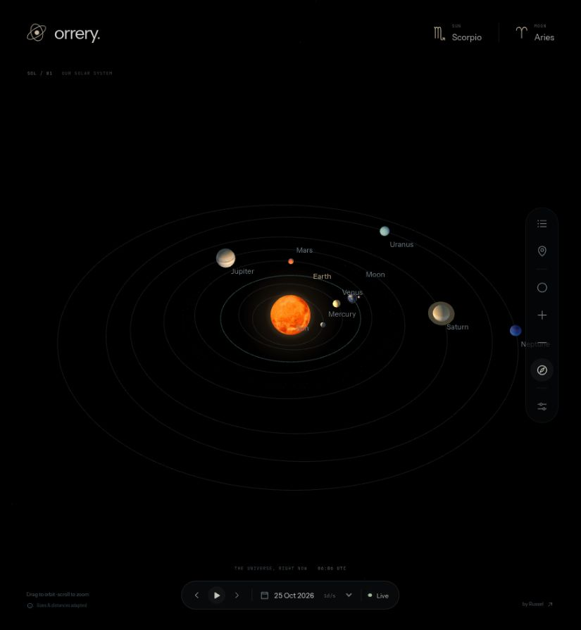

# Orrery

A little solar system you can wander around. Full-screen 3D, a black sky, and real orbital calculations. Rewind to a date, get closer to a planet, or find out what’s above your own corner of Earth.

[Explore Orrery](https://solar-system-pink-pi.vercel.app)



## Run locally

```sh
cd next
npm ci
npm run dev
```

Open [localhost:3000](http://localhost:3000). Node.js 20.9+ required. No API keys or environment files needed.

`npm run build` builds production. `npm run lint`, `npm run typecheck` and `npm test` run the checks.

## A little context

Built with Next.js, TypeScript, Three.js and [Astronomy Engine](https://github.com/cosinekitty/astronomy). Dates cover 1900–2100; all displayed times are UTC. Positions are calculated, while sizes and orbital distances are adapted for exploring. The Moon and Jupiter’s four Galilean moons are included. Observer location stays in browser localStorage.

The small sign display uses the tropical zodiac; it is separate from astronomical constellations. Open **Science & sources** in the app for accuracy, scale and sky-chart details.

Planet textures: [Solar System Scope](https://www.solarsystemscope.com/textures/), based on NASA imagery, [CC BY 4.0](https://creativecommons.org/licenses/by/4.0/).
